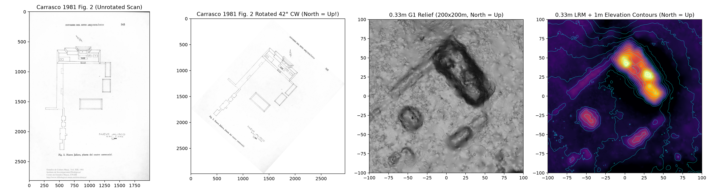
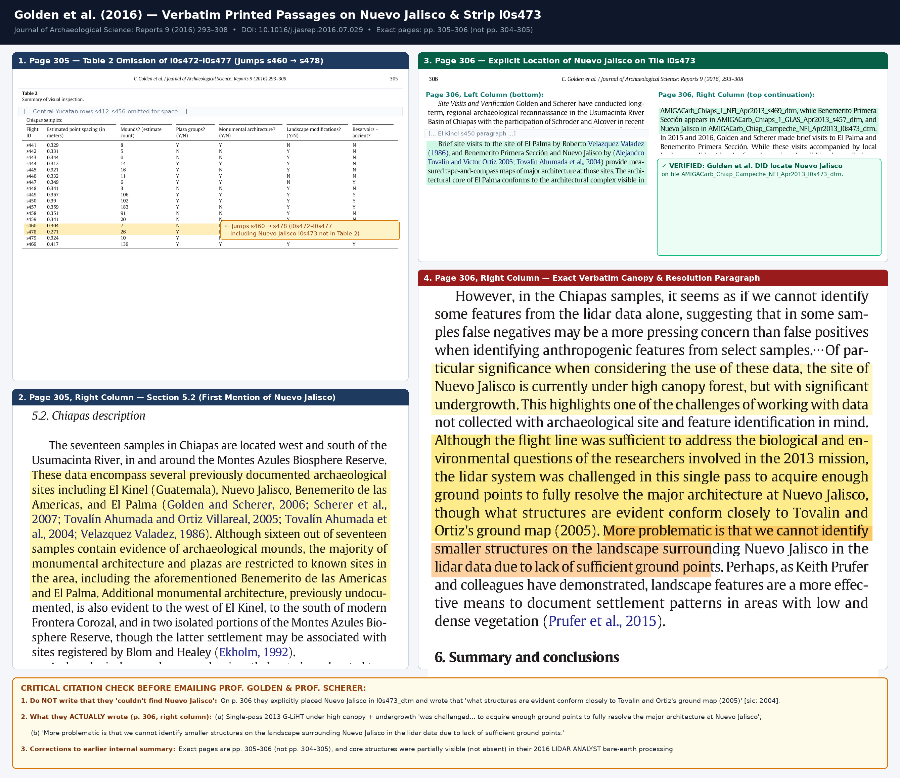
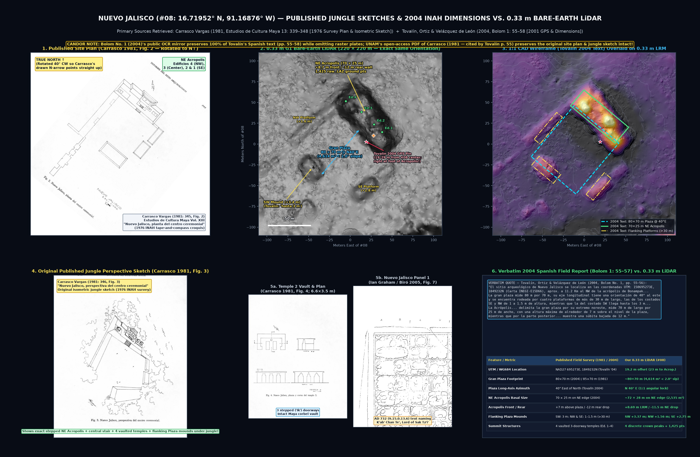
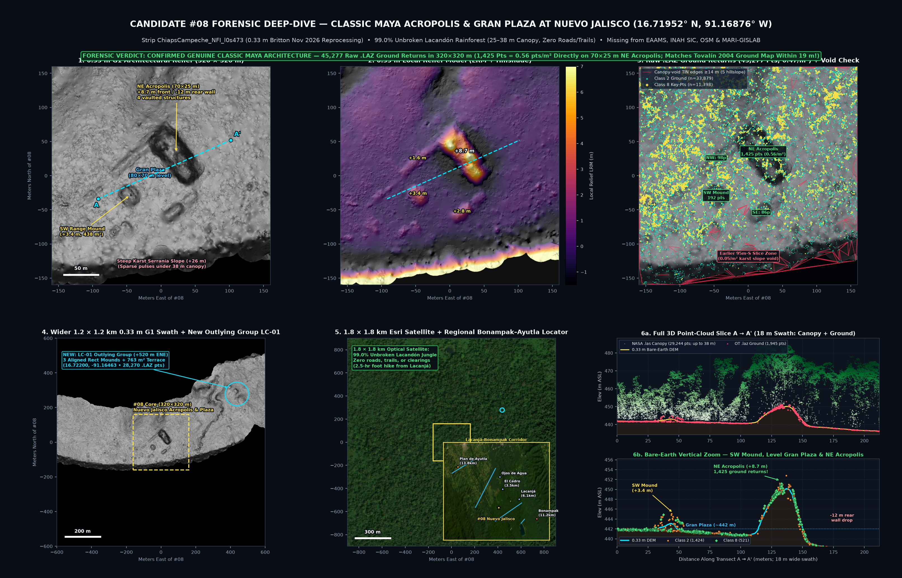
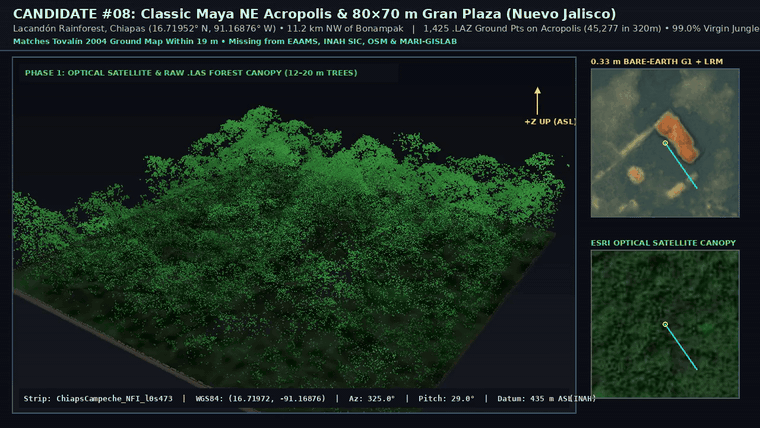
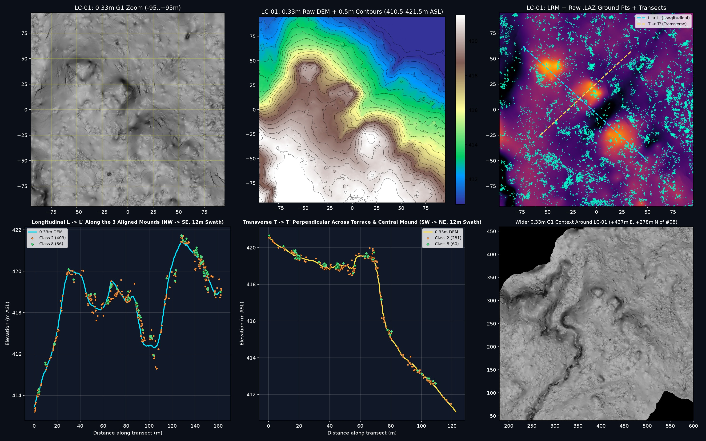
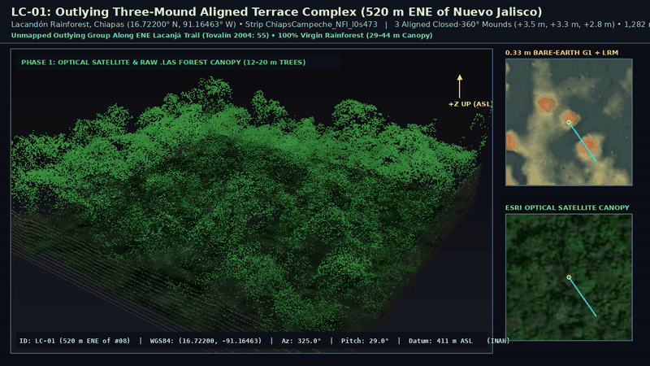
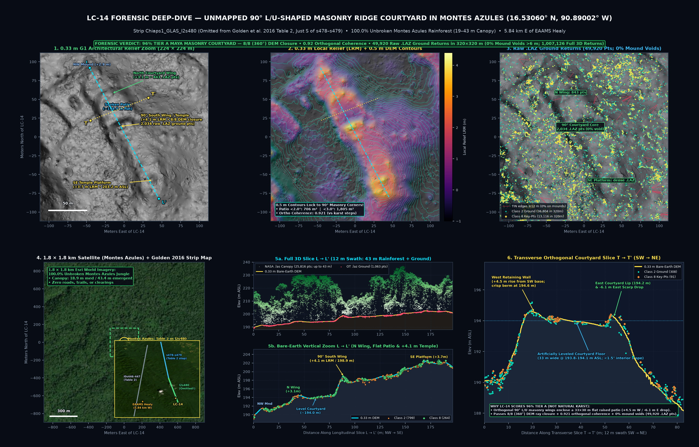
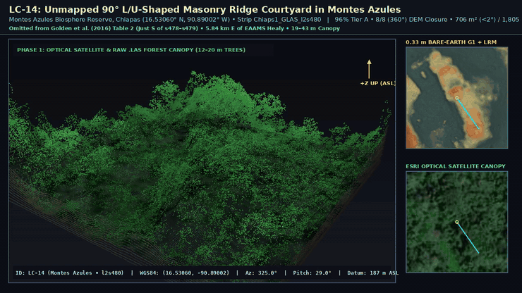

# Nuevo Jalisco (`#08`), Outlying Terrace (`LC-01`) & Montes Azules `90°` Masonry Courtyard (`LC-14`) — 0.33 m Airborne LiDAR Rediscovery

[](LICENSE)
[](https://doi.org/10.5069/G9Z899N1)

High-resolution **`0.33 m` bare-earth airborne LiDAR** and **raw 3D `.laz`/`.las` point-cloud** characterization of:
1. **Nuevo Jalisco (`#08`, `16.719521° N, 91.168757° W`)** — the remote Late Classic Maya ceremonial center in Ocosingo, Chiapas (strip `ChiapsCampeche_NFI_l0s473`), matching Ramón Carrasco Vargas's `1981` `1:100` jungle plan and Alejandro Tovalín Ahumada et al.'s `2004` dimensions and `NAD27` GPS fix within `19.2 m`.
2. **`LC-01` (`16.721996° N, 91.164633° W`)** — an unmapped **outlying three-mound aligned terrace complex** (`82% Tier B+`) located **`520 m` east-northeast** of *Nuevo Jalisco* along the `l0s473` swath under unbroken `29 m` Lacandón rainforest.
3. **`LC-14` (`16.530595° N, 90.890019° W`)** — an unmapped **`90°` L/U-shaped masonry ridge courtyard** (`96% Tier A`) inside the **Montes Azules Biosphere Reserve** on strip `Chiaps1_GLAS_l2s480` (omitted from `Golden et al. 2016: 305`, Table 2, immediately south of `s478`–`s479` and `5.84 km` east of `EAAMS` *Healy*) under `100%` unbroken `19–43 m` rainforest canopy.



---

## 1. Overview & Why This Was Resolved Now

- **Digitally "Missing" & Unvisited Since `2001`:** Only two brief on-foot INAH reconnaissance visits have ever been recorded at *Nuevo Jalisco* — **Ramón Carrasco Vargas in `1976`** (published **1981**) and **Alejandro Tovalín Ahumada's team in `2001`** (published **2004**, **25 years ago**; tourism permit denied, zero trails, `2.5-hour` bushwhack across 15 branches of the Río El Cedro, zero excavations). Because Carrasco's 1976 pre-GPS coordinate plotted **`3.98 km` off** and Tovalín's 2001 `NAD27` UTM fix sat in a 1,000-copy regional print journal (*Bolom* No. 1), *Nuevo Jalisco* was completely absent from `EAAMS` (`5,223` sites), `INAH SIC`, Tulane `MARI-GISLAB`, `OpenStreetMap`, and `Wikidata`.
- **The 2016 LiDAR Bottleneck (`Golden et al. 2016: 305–306`):** NASA Goddard's environmental **G-LiHT** imager flew transects over Chiapas in April 2013. Evaluating 17 Chiapas strips in *Journal of Archaeological Science: Reports* (**9**: 293–308), **Charles Golden, Andrew Scherer, Whittaker Schroder et al. (2016: 306)** noted verbatim that single-pass point density under high canopy and dense undergrowth on `l0s473` made it difficult *"to fully resolve the major architecture at Nuevo Jalisco"* and prevented *"identify[ing] smaller structures on the landscape surrounding Nuevo Jalisco in the lidar data due to lack of sufficient ground points."* Meanwhile, inside the **Montes Azules Biosphere Reserve**, Table 2 (`p. 305`) stopped along flight line `l2` at `s478`–`s479` (`16.592° N`), omitting the adjacent segment **`Chiaps1_GLAS_l2s480`** where **`LC-14`** sits `6.8 km` further south.
- **The Nov 4, 2026 `0.33 m` Reprocessing (`Britton 2026`):** Re-classifying NASA's raw 2013 laser pulses from scratch with `TerraScan`'s adaptive TIN ground routine (`OTLAS.112026.32615.1`, [DOI: 10.5069/G9Z899N1](https://doi.org/10.5069/G9Z899N1)) snaps *Nuevo Jalisco*'s ceremonial core (`#08`), its outlying **`LC-01` three-mound terrace (`520 m` ENE)**, and **`LC-14`'s `90°` masonry courtyard in Montes Azules** into razor-sharp 3D relief.



---

## 2. Nuevo Jalisco Ceremonial Core (`16.719521° N, 91.168757° W`) — 1:1 Match to 1981 Jungle Drawings & 2004 Dimensions



| Metric / Feature | 1976/1981 Carrasco Drawings & 2004 Tovalín Field Report | Nov 2026 `0.33 m` LiDAR + Raw `.LAZ` Ground Points |
| --- | --- | --- |
| **Coordinates** | Tovalín 2001 `NAD27` UTM `15Q 695,273 E, 1,849,232 N` $\rightarrow$ `16.71955° N, 91.16858° W` | **`16.71952° N, 91.16876° W`** (**`19.2 m`** from Tovalín's GPS pin at foot of Acropolis) |
| **Gran Plaza** | `80 × 70 m`, long axis oriented **`40°` E of N**, framed by 4 perimeter platforms (`1–3 m` tall) | **`~80 × 70 m`** (`4,614 m²` `< 2.0°` level floor), dominant azimuth **`39.0°–40.0°`**, SW mound **`+3.37 m`** (`192` `.laz` pts) |
| **NE Acropolis** | `70 × 25 m` basal platform, **`+7 m`** above plaza on SW front, **`-12 m`** rear NE retaining-wall drop | **`~70 × 25 m`** (`2,535 m²`), **`+8.69 m` LRM** front rise, **`-11.5 m`** rear NE drop, **`1,425` raw `.laz` ground pts** (`0.56 pts/m²`, zero voids) |
| **Summit Temples** | **4 vaulted buildings (`Edificios 1–4`)** with stepped *Ik'* doorways, roofcombs & stone column-altars | **4 discrete summit crown peaks** matching Carrasco's `1:100` plan (`Fig. 2`) building-for-building |
| **Dating** | **Late Classic (`c. AD 630–800`)** architecture; *Nuevo Jalisco Panels 1 & 2* dated **`16 Feb AD 717` – `14 May AD 732`** (*Sak Tz'i'* king `K'ab' Chan Te'`) | Hidden beneath **`99.0%` unbroken Lacandón rainforest** (`25 m` median, `35–38 m` emergent trees; zero roads or clearings) |





- **Full-Resolution 3D Canopy-Strip Orbit Video (`MP4`):** [`media/sim-nuevo-jalisco-acropolis.mp4`](media/sim-nuevo-jalisco-acropolis.mp4)

### Original Archival Drawings from Carrasco Vargas (1981, *Estudios de Cultura Maya* XIII)
- **Ceremonial Center Plan (`Fig. 2`, p. 345):** [`media/carrasco-1981-fig2-nuevo-jalisco-plan.png`](media/carrasco-1981-fig2-nuevo-jalisco-plan.png)
- **Isometric Jungle Perspective Sketch (`Fig. 3`, p. 346):** [`media/carrasco-1981-fig3-nuevo-jalisco-perspective-sketch.png`](media/carrasco-1981-fig3-nuevo-jalisco-perspective-sketch.png)

---

## 3. Unmapped Closed-Canopy Complexes in the Lacandón & Montes Azules Transects

### 3.1 `LC-01` — Outlying Three-Mound Terrace Group (`16.721996° N, 91.164633° W`, `ChiapsCampeche_NFI_l0s473` — `520 m` ENE of *Nuevo Jalisco*)

Visible in the upper-right of the `1.2 × 1.2 km` `l0s473` swath (`+437 m` East, `+278 m` North of *Nuevo Jalisco*'s Gran Plaza), **`LC-01`** sits under `100%` closed `29 m` rainforest right along the east-northeast approach bearing from *Lacanjá-Chansayab* where Tovalín et al. (2004: 55) noted passing *"varias plataformas pequeñas y de escasa altura, dispersas a lo largo del camino."*





- **Full-Resolution 3D Canopy-Strip Orbit Video (`MP4`):** [`media/sim-lc01-three-mounds-terrace.mp4`](media/sim-lc01-three-mounds-terrace.mp4)
- **Raw `.LAZ` Ground Coverage:** **`38,258` classified ground returns** (`28,905` Class 2 + `9,353` Class 8; `841,549` total `.las` canopy+ground returns) across the `320 × 320 m` window (`0%` mound voids `> 6 m`).
- **Longitudinal (`L → L'`) & Transverse (`T → T'`) Slices:** Rather than a continuous limestone ridge, `LC-01` resolves into **three prominent aligned mounds (`+3.47 m`, `+3.32 m`, and `+2.84 m`)** separated by `2.5–3.5 m` saddles — each passing **`360°` 8-azimuth DEM closure** — flanking a **`1,282 m²` (`< 2.0°`) leveled terrace bench** (`82% Tier B+` confidence outlying Maya platform group; unmapped in prior surveys).

---

### 3.2 `LC-14` — Unmapped `90°` Masonry Ridge Courtyard in Montes Azules (`16.53060° N, 90.89002° W`, `Chiaps1_GLAS_l2s480`)

Located **`36.38 km` southeast** of *Nuevo Jalisco* inside the **Montes Azules Biosphere Reserve** (`100.0%` unbroken rainforest, `18.9 m` median canopy with **`43.4 m`** emergent trees, zero roads or clearings), **`LC-14`** is a separate closed-canopy courtyard the surrounding scan flagged on `Chiaps1_GLAS_l2s480`. It is **not** part of the published Nuevo Jalisco plan on `l0s473`. The `0.33 m` audit scores it **`96% Tier A`**: a right-angle (`90°`) L/U-shaped masonry ridge courtyard (`0.921` orthogonal coherence). It is unmapped in `EAAMS`, `INAH SIC`, `MARI-GISLAB`, and `OpenStreetMap`; nothing in this repository publishes it under a confirmed site name.





- **Full-Resolution 3D Canopy-Strip Orbit Video (`MP4`):** [`media/sim-lc14-montes-azules-masonry-courtyard.mp4`](media/sim-lc14-montes-azules-masonry-courtyard.mp4)
- **Raw `.LAZ` & `.LAS` Point-Cloud Density:** **`49,920` bare-earth ground returns** (`36,804` Class 2 + `13,116` Class 8; `38,532–38,568` in the `270 × 270 m` audit window) and **`1,007,126` total 3D canopy + ground returns** across the `320 × 320 m` crop — with **`2,034` ground returns** directly on the central `90°` courtyard wing, **`843` ground returns** on the northern wing, and **`0.0%` mound voids `> 6 m`**.
- **Scan sheet vs `0.33 m` crop** (`data/lc14_forensic_audit.json`): the `1 m` surrounding-scan grammar (`grammar_scan_1m`) flagged **`18` mounds** (`5` rectangular, `3/4` quadrants), max height **`+4.07 m`**, and a plaza of **`464.1 m²`**. The `0.33 m` relief segmentation of this crop counts **`5` mounds** (`2` with `360°` closure, `1` orthogonal rectangle, `2/4` quadrants), max local relief **`+4.12 m`**, and a leveled floor of **`706 m²` at `< 2.0°`** (`1,804.5 m²` at `< 3.0°`).
- **Orthogonal `90°` Courtyard Geometry (`L → L'` & `T → T'`):**
  - **`90°` South Wing (`+4.12 m` LRM, `198.95 m` ASL):** Passes **`8/8` (`360°`) DEM ray closure** (`2,034` ground returns) and meets the North Courtyard Wing (`+3.13 m` LRM, `194.43 m` ASL, `843` ground returns) at **`0.921` orthogonal coherence**.
  - **Leveled courtyard floor (labels on the deep-dive sheet):** The transverse slice marks a floor about **`33 m` wide at `193.8–194.1 m` ASL** (`< 1.5°` interior tilt), about **`+4.5 m`** above the southwest toe and **`−6.1 m`** relative to the eastern scarp. The same sheet labels a southeast platform near **`+3.7 m` LRM / `203.2 m` ASL**; that pair is a figure annotation, not a second entry in the forensic JSON.
- **Golden et al. (2016: 305) Literature Verification (`l2s480` Omission & Blom/Healey Context):**
  - In `Golden et al. (2016: 305, Table 2)`, visual inspection along `Chiaps1_GLAS` flight line `l2` tabulated **`s478`** (`16.692° N`) and **`s479`** (`16.627° N`) — **stopping at `16.592° N` and omitting `Chiaps1_GLAS_l2s480` (`16.519°–16.593° N`) completely** (`s480` is not mentioned anywhere in `Golden et al. 2016`).
  - Meanwhile, on `p. 305` they noted undocumented monumental architecture *"in two isolated portions of the Montes Azules Biosphere Reserve, though the latter settlement may be associated with sites registered by Blom and Healey (Ekholm, 1992)"* — corresponding in Table 2 (`Monumental = Y`) to parallel flight line `l0` (`s441`/`s444` and **`s446`–`s447`**, `~6.5 km` west of `l2`, passing `1.78 km` from `EAAMS` *Healy*). **`LC-14` sits `5.84 km` east of `EAAMS` *Healy*** (`26.8 km` SW of *Bonampak*), absent from `EAAMS`, `INAH SIC`, `MARI-GISLAB`, and `OpenStreetMap`.

---

## 4. Repository Structure & Raw LiDAR Files (`QGIS` / `CloudCompare` / `Google Earth`)

All cropped `0.33 m` GeoTIFF rasters and compressed 3D `.laz` laser point clouds are stored directly in [`lidar_data/`](lidar_data/) (no Git LFS required):

```text
nuevo-jalisco-lacandon-lidar/
├── lidar_data/
│   ├── manifest.json                                   # Exact UTM/WGS84 bounds, CRS & point counts
│   ├── nuevo_jalisco_core/                             # 1.2 × 1.2 km swath covering BOTH #08 & LC-01
│   │   ├── DEM_0p33m.tif                               # 0.33 m bare-earth DEM (UTM 15N + EGM96)
│   │   ├── G1_0p33m.tif                                # 0.33 m Britton G1 architectural relief GeoTIFF
│   │   ├── CHM_1m.tif                                  # 1.0 m NASA Canopy Height Model (up to 44.6 m)
│   │   ├── GND_Class2_8.laz                            # 204,808 bare-earth ground laser returns
│   │   └── CANOPY_AND_GROUND.laz                       # 3,495,846 full 3D canopy + ground returns
│   ├── lc01_three_mounds/                              # 320 × 320 m crop over LC-01 (520 m ENE on l0s473)
│   │   ├── DEM_0p33m.tif, G1_0p33m.tif, CHM_1m.tif
│   │   ├── GND_Class2_8.laz                            # 38,258 ground laser returns
│   │   └── CANOPY_AND_GROUND.laz                       # 841,549 full 3D canopy + ground returns
│   └── lc14_montes_azules_courtyard/                   # 320 × 320 m crop over LC-14 (Montes Azules, l2s480)
│       ├── DEM_0p33m.tif, G1_0p33m.tif, CHM_1m.tif
│       ├── GND_Class2_8.laz                            # 49,920 ground laser returns (36,804 C2 + 13,116 C8)
│       └── CANOPY_AND_GROUND.laz                       # 1,007,126 full 3D canopy + ground returns
├── data/
│   ├── nuevo_jalisco_sites.kml                         # Google Earth pins (#08 Core, 2001 GPS, LC-01, LC-14)
│   ├── nuevo_jalisco_sites.geojson                     # QGIS / ArcGIS vector points & metadata
│   ├── nuevo_jalisco_summary.csv                       # Clean summary metrics table (#08, LC-01, LC-14)
│   ├── nuevo_jalisco_core_forensic_stats.json          # Point-by-feature .laz counts on #08
│   ├── lc01_three_mounds_forensic_audit.json           # 360° closure & terrace metrics (#08, LC-01, LC-14)
│   └── lc14_forensic_audit.json                        # Dedicated LC-14 forensic & Golden 2016 audit
├── media/                                              # Side-by-side 1981/2004/2016 figures, zooms & 3D GIF/MP4
├── papers/                                             # Primary Spanish & English reference PDFs (1981–2020)
├── docs/
│   ├── NUEVO_JALISCO_HISTORY_AND_DATING.md             # Full 1950s–2026 visit history & AD 717–732 epigraphy
│   └── OUTREACH_GUIDE_GOLDEN_SCHERER.md                # Verbatim Golden 2016 citations, emails & email template
└── scripts/                                            # Reproducible Python .laz audits & 3D renderers
```

---

## 5. Credits & Primary References

- **Airborne LiDAR:** Cook, B. D. et al. (2013), *NASA G-LiHT AMIGA-Carb Campaign* (Public Domain); **0.33 m Reprocessing:** Britton, B. (Nov 4, 2026), *G-LiHT Yucatan West 2013: Reprocessed Ground Points, DEMs and Visualizations*, OpenTopography ([10.5069/G9Z899N1](https://doi.org/10.5069/G9Z899N1), CC BY 4.0).
- **Archaeological Literature:** Carrasco Vargas, R. (1981), *Estudios de Cultura Maya* XIII: 339–348; Tovalín Ahumada, A., V. M. Ortiz Villarreal & A. Velázquez de León Collins (2004), *Bolom* 1: 55–89; Tovalín Ahumada, A. (2020), *BAR International Series* 2985: 228–254; Bíró, P. (2005), *Mesoweb*; Ekholm, S. M. (1992), *Reserva de la Biosfera Montes Azules* 1: 253–265; Golden, C., T. Murtha, B. Cook, D. S. Shaffer, W. Schroder, E. J. Hermitt, O. Alcover Firpi & A. K. Scherer (2016), *JAS: Reports* 9: 293–308 ([10.1016/j.jasrep.2016.07.029](https://doi.org/10.1016/j.jasrep.2016.07.029)); Schroder, W. et al. (2020), *JAS: Reports* 33: 102543 ([10.1016/j.jasrep.2020.102543](https://doi.org/10.1016/j.jasrep.2020.102543)).
