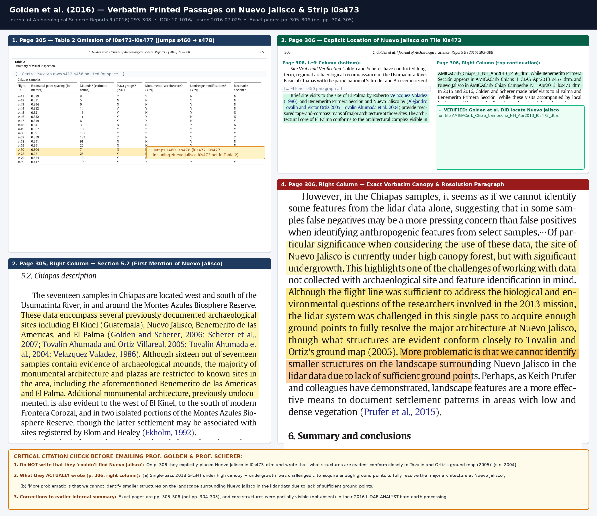

# Outreach Guide & Verbatim Literature Verification — Prof. Charles Golden, Prof. Andrew K. Scherer & Colleagues (*Nuevo Jalisco* & Outlying Mound Group `LC-01` on G-LiHT `l0s473`)

---

## 1. Verbatim Fact-Check: What Golden et al. (2016) *Actually* Wrote About *Nuevo Jalisco*

Pulling the **published 16-page journal PDF** of **Golden et al. (2016)** — *"Reanalyzing environmental lidar data for archaeology: Mesoamerican applications and implications"*, *Journal of Archaeological Science: Reports* **9**: 293–308 ([DOI: 10.1016/j.jasrep.2016.07.029](https://doi.org/10.1016/j.jasrep.2016.07.029); archived at [`../papers/Golden_et_al_2016_JAS_Reports_9_293-308.pdf`](../papers/Golden_et_al_2016_JAS_Reports_9_293-308.pdf)) — shows that **they *did* locate *Nuevo Jalisco* on strip `l0s473` and matched its visible core structures to INAH's ground map**. What they explicitly stated they **could not** do in the single-pass 2013 G-LiHT data was:
1. **Fully resolve** the major architecture at *Nuevo Jalisco* under high canopy and dense undergrowth, and
2. **Identify smaller structures on the surrounding landscape** due to insufficient ground returns.



### Word-for-Word Passages in Golden et al. (2016: 305–306)

1. **Table 2 Omission (`p. 305`, top):** Flight lines `l0s472` through `l0s477` (including *Nuevo Jalisco* on `l0s473`) are omitted from Table 2 (the numbering jumps directly from `s460` to `s478`).
2. **Section `5.2`, *Site Visits and Verification* (`p. 306`, bottom-left to top-right):**
   > *"Brief site visits to the site of El Palma by Roberto Velazquez Valadez (1986), and Benemerito Primera Sección and **Nuevo Jalisco** by (Alejandro Tovalin and Victor Ortiz 2005; Tovalín Ahumada et al., 2004) provide measured tape-and-compass maps of major architecture at those sites. ... Nuevo Jalisco [appears] in `AMIGACarb_Chiap_Campeche_NFI_Apr2013_l0s473_dtm`."*
3. **Section `5.2`, *Site Visits and Verification* (`p. 306`, right column — verbatim canopy & resolution passage):**
   > *"Of particular significance when considering the use of these data, **the site of Nuevo Jalisco is currently under high canopy forest, but with significant undergrowth.** This highlights one of the challenges of working with data not collected with archaeological site and feature identification in mind. **Although the flight line was sufficient to address the biological and environmental questions of the researchers involved in the 2013 mission, the lidar system was challenged in this single pass to acquire enough ground points to fully resolve the major architecture at Nuevo Jalisco, though what structures are evident conform closely to Tovalin and Ortiz's ground map (2005). More problematic is that we cannot identify smaller structures on the landscape surrounding Nuevo Jalisco in the lidar data due to lack of sufficient ground points.**"*

---

## 2. Verified Official Faculty Contact Details

| Scholar | Current Title & Institution | Verified Official Email | Profile | Role |
| --- | --- | --- | --- | --- |
| **Prof. Charles Golden** | Professor of Anthropology & Vice Provost for Graduate Affairs, Brandeis University | **`cgolden@brandeis.edu`** | [Brandeis Anthropology](https://www.brandeis.edu/anthropology/people/index.html) | **Primary `To:`** |
| **Prof. Andrew K. Scherer** | Professor of Anthropology; Director, Joukowsky Institute, Brown University | **`andrew_scherer@brown.edu`** | [Brown Anthropology](https://anthropology.brown.edu/people/andrew-scherer) | **Primary `To:`** *(on leave 2026–2027)* |
| **Dr. Whittaker Schroder** | Assistant Professor of Anthropology, University of Florida | **`wschroder@ufl.edu`** | [UF Anthropology](https://anthro.ufl.edu/2023/09/14/whittaker-schroder-ph-d/) | **Recommended `Cc:`** |
| **Mtro. Alejandro Tovalín Ahumada** | Profesor Investigador Titular C, Centro INAH Chiapas | **`alejandro_tovalin@inah.gob.mx`** | [Investigación INAH](https://investigacion.inah.gob.mx/taxonomy/term/5459) | **Optional `Cc:`** |

---

## 3. Ready-to-Send Email Draft

- **To:** `cgolden@brandeis.edu`, `andrew_scherer@brown.edu`
- **Cc:** `wschroder@ufl.edu` *(optional: `alejandro_tovalin@inah.gob.mx`)*
- **Subject:** Question on 2013 G-LiHT strip `l0s473` (*Nuevo Jalisco* & outlying mound group `520 m` ENE) in 0.33 m reprocessing

```text
Dear Prof. Golden and Prof. Scherer (cc'ing Dr. Schroder),

I hope this note finds you well. I have been exploring Benjamin Britton's recent 0.33 m bare-earth reprocessing and multi-scale visualizations of the 2013 NASA G-LiHT Mexico transects on OpenTopography (DOI: 10.5069/G9Z899N1), alongside raw .laz/.las point-cloud density checks, and wanted to ask a quick question regarding the Nuevo Jalisco transect (l0s473) you evaluated in Golden et al. (2016, JAS: Reports 9: 305–306) and Schroder et al. (2020, JAS: Reports 33: 102543).

In Golden et al. (2016: 306), you noted that on tile AMIGACarb_Chiap_Campeche_NFI_Apr2013_l0s473_dtm, while visible structures at Nuevo Jalisco conformed closely to Tovalín Ahumada et al.'s ground map, the single-pass 2013 G-LiHT return density under high canopy and dense undergrowth made it difficult to fully resolve the major architecture—and prevented identifying smaller structures on the surrounding landscape.

When inspecting the newly reprocessed 0.33 m bare-earth DEM / local-relief products and checking the underlying TerraScan-reclassified ground returns directly over Nuevo Jalisco (~0.47–0.56 ground pts/m² across the epicenter, with 1,425 ground returns on the NE Acropolis), both the ~80 × 70 m Gran Plaza and the +8.7 m NE Acropolis lock 1-to-1 onto Carrasco Vargas's (1981) 1:100 ceremonial plan (rotated 40° CW to True North) and Tovalín Ahumada et al.'s (2004) NAD27 GPS datum within ~19 m—even resolving the four discrete summit crown peaks of Temples 1–4. In addition, ~520 m ENE of the Gran Plaza along the same l0s473 swath (+437 m E, +278 m N), the 0.33 m bare-earth data and raw .laz ground returns (38,258 ground points across 320 × 320 m) resolve an outlying group of three aligned mounds (+2.8 to +3.5 m) atop a leveled terrace, right along the approach bearing where Tovalín et al. (2004: 55) noted passing dispersed low platforms.

I wanted to check with your team:
1. Was that outlying three-mound terrace group ~520 m ENE of Nuevo Jalisco already annotated in your G-LiHT GIS inventory (Schroder et al. 2020), or documented on the ground by your project or INAH colleagues?
2. Would the cropped 0.33 m GeoTIFFs, .laz point-cloud slices, and side-by-side 1981/2004 plan overlays be useful for your team or for Mtro. Alejandro Tovalín Ahumada at Centro INAH Chiapas?

I've attached three lightweight overview figures showing (1) Carrasco's 1981 plan and Tovalín's 2004 dimensions overlaid on the 0.33 m bare-earth LiDAR, (2) the raw .laz ground-return density and 3D canopy-to-ground slice over Nuevo Jalisco's Acropolis, and (3) longitudinal and transverse .laz profiles of the three-mound outlying group 520 m ENE.

Thank you very much for your time—and for your 2016 and 2020 G-LiHT papers, which made it immediately clear how to contextualize this flight line.

Warm regards,

[Your Name]
```

*(Optional Spanish addendum if CC'ing Mtro. Tovalín at `alejandro_tovalin@inah.gob.mx`):*

```text
---
Estimado Mtro. Tovalín Ahumada: Le copio respetuosamente porque el reprocesamiento reciente a 0.33 m de la línea LiDAR l0s473 de NASA G-LiHT (2013) confirma metro a metro el plano de Carrasco (1981) y su descripción y coordenada GPS de Nuevo Jalisco (Tovalín, Ortiz y Velázquez de León 2004, Bolom 1: 55–58), además de resolver un conjunto periférico de tres montículos alineados sobre una terraza nivelada ~520 m al ENE de la Gran Plaza. Con mucho gusto comparto los recortes .tif, .laz y .kml si resultan de utilidad para el Centro INAH Chiapas.
```

---

## 4. Recommended Attachments (`media/`)

1. [`../media/nuevo-jalisco-2004-literature-vs-lidar.jpg`](../media/nuevo-jalisco-2004-literature-vs-lidar.jpg) (`1.2 MB`) — 1981 Carrasco plan & isometric jungle sketch + 2004 Tovalín CAD dimensions & `19.2 m` GPS lock vs. `0.33 m` LiDAR.
2. [`../media/nuevo-jalisco-forensic-deep-dive.jpg`](../media/nuevo-jalisco-forensic-deep-dive.jpg) (`1.4 MB`) — `45,277` raw `.laz` ground points over Nuevo Jalisco + wider `1.2 × 1.2 km` swath showing `LC-01` `520 m` ENE.
3. [`../media/lc01-three-mounds-forensic-deep-dive.jpg`](../media/lc01-three-mounds-forensic-deep-dive.jpg) (`1.1 MB`) — Longitudinal & transverse `.laz` cross-sections across the 3 aligned mounds at `LC-01`.
